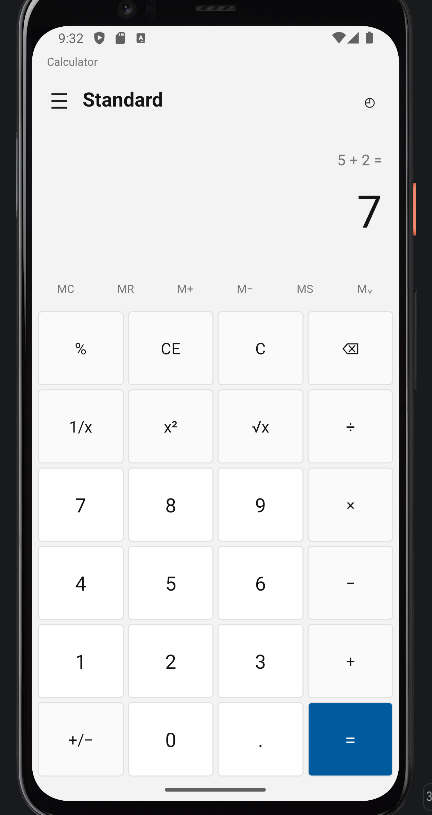
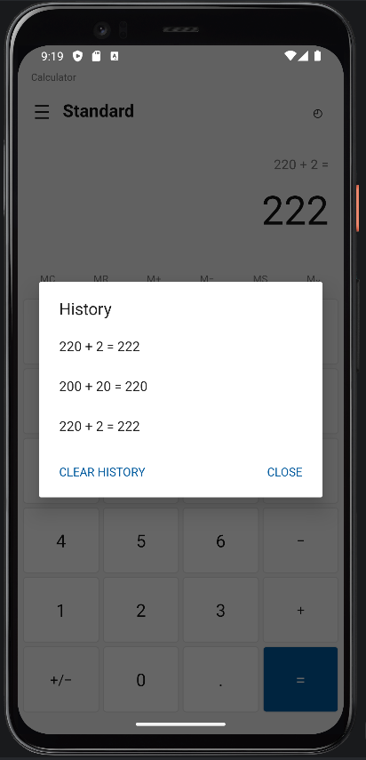

# Calculator App — MADT Lab #4 (Viber)

An Android **Standard-style calculator** built for the *Mobile Applications Development Techniques* (MADT) laboratory assignment. The interface follows the provided Windows Calculator reference, adapted for a portrait Android screen. The app is implemented in **Java and XML**, with calculation logic written from scratch using the Java standard library.

## Screenshots

| Calculator | Calculation history |
|:---:|:---:|
|  |  |

*Captured by the student on the Pixel 6 API 35 Android emulator after the Code Review fixes.*

## Features

- **Standard operations:** addition (`+`), subtraction (`−`), multiplication (`×`), and division (`÷`).
- **Unary operations:** percentage (`%`), reciprocal / fraction (`1/x`), square (`x²`), and square root (`√x`).
- **Input editing:** decimal point, sign toggle (`+/−`), backspace (`⌫`), clear entry (`CE`), and clear calculation (`C`).
- **Memory:** `MC` (clear), `MR` (recall), `M+` (add), `M−` (subtract), `MS` (store), and `M⌄` (view stored value).
- **Calculation history:** a newest-first dialog displaying previous calculations; tap an entry to recall its result, or use **Clear History**. Up to **100 entries** are kept in memory.
- **Error messages** for division by zero, reciprocal of zero, and square root of a negative number.
- **Localizable UI labels:** button text and on-screen messages are stored in `app/src/main/res/values/strings.xml`, not hard-coded in Java.

### Calculation examples

The notation below represents **button presses in order**, not text to type into a single input field.

| Button sequence | Result | Explanation |
|---|---:|---|
| `12` `+` `8` `=` | `20` | Addition |
| `7` `−` `12` `=` | `-5` | Subtraction |
| `6` `×` `7` `=` | `42` | Multiplication |
| `1` `÷` `8` `=` | `0.125` | Division |
| `9` `√x` | `3` | Square root |
| `5` `x²` | `25` | Square |
| `8` `1/x` | `0.125` | Reciprocal of a number |
| `200` `+` `10` `%` `=` | `220` | 10% of 200 is 20; add 20 |
| `200` `×` `10` `%` `=` | `20` | Multiply by 10% |
| `8` `÷` `0` `=` | `Cannot divide by zero` | Handled error state |

**Percentage behavior:** with `+` or `−` pending, the entered percentage is calculated relative to the left operand; with `×` or `÷`, it is treated as a fraction of 100. Pressing `%` on its own converts the entered number to a percentage value (for example, `25 %` produces `0.25`).

## Requirements

- **Android Studio** with Android SDK **35** available (compile SDK 35).
- **JDK 21** for the Gradle daemon/toolchain, as specified by `gradle/gradle-daemon-jvm.properties`. Java source/target compatibility is set to **Java 17**.
- Android Gradle Plugin **8.9.2** and Gradle Wrapper **8.11.1** (Gradle downloads the wrapper distribution as needed).
- Android device/emulator running **API 23 or higher**. The project was run on a **Pixel 6 emulator with API 35**.
- Network access for first-time Gradle dependency downloads may be required.

No external arithmetic library or third-party UI framework is used. The local unit tests use **JUnit 4.13.2**.

## Build and run

1. Extract the project ZIP and locate the folder **`MADT_Lab4_Calculator`**.
2. In Android Studio, use **File → Open** and select that folder (the one containing `settings.gradle.kts`).
3. Allow **Gradle Sync** to finish; if Android Studio asks for a Gradle JDK, use **JDK 21**.
4. Select an Android device or the **Pixel 6 API 35** emulator and choose the **`app`** run configuration.
5. Click **Run** (▶) to build, install, and launch the calculator.

To run the unit tests, open the Android Studio terminal in the project root.

**Windows (PowerShell):**

```powershell
.\gradlew.bat :app:testDebugUnitTest
```

**macOS / Linux:**

```bash
./gradlew :app:testDebugUnitTest
```

**Verification:** On 5 November 2026, the student successfully executed the Windows Gradle unit-test command (`BUILD SUCCESSFUL`), launched the reviewed version on a Pixel 6 API 35 emulator, checked calculation results, and opened the history dialog. The source contains **60 Java unit tests**, including **13 regression tests** introduced during the separate Code Review session. This does not imply that every Android UI or lifecycle edge case was instrumented and tested.

## Architecture and project files

```text
MADT_Lab4_Calculator/
├── app/
│   ├── build.gradle.kts
│   └── src/
│       ├── main/
│       │   ├── AndroidManifest.xml
│       │   ├── java/com/example/madtlab4/
│       │   │   ├── MainActivity.java
│       │   │   └── CalculatorEngine.java
│       │   └── res/
│       │       ├── layout/activity_main.xml
│       │       ├── drawable/
│       │       └── values/strings.xml
│       └── test/java/com/example/madtlab4/CalculatorEngineTest.java
├── docs/screenshots/
├── gradle/wrapper/
├── gradlew / gradlew.bat
└── README.md
```

- **`CalculatorEngine.java`**: pure-Java calculator state machine; handles arithmetic, percentage rules, memory, errors, and a bounded history. Uses `BigDecimal` with a 16-significant-digit `MathContext` for most calculations, and standard `Math.sqrt` for square roots.
- **`MainActivity.java`**: connects Android buttons, dialogs, display, and system insets to the engine. Calculation logic is not duplicated in the Activity.
- **`activity_main.xml` and resource files**: portrait-oriented 6 × 4 keypad, memory row, display, colors, styles, and externalized strings.
- **`CalculatorEngineTest.java`**: JUnit regression tests for calculation cases and engine state transitions.

## State, history, and limitations

- **History and memory are runtime-only.** The Activity saves the engine with `onSaveInstanceState`, so state can be restored after Android recreates the Activity; it is **not persistently saved** after a fresh app start or an explicit force-stop. State recreation behavior was not exhaustively tested on-device.
- The application is **portrait-only**, as specified in `AndroidManifest.xml`.
- Repeatedly squaring extremely large numbers may produce a value that exceeds the `double` range used by `Math.sqrt`. In that unusual case, attempting `√x` can trigger an unhandled `NumberFormatException`. This is a **known limitation**, retained because the Code Review session was restricted to its two selected priority fixes.
- The interface was compared to the assignment's Standard calculator reference and manually inspected on a Pixel 6 API 35 emulator; pixel-identical reproduction and accessibility testing across all screen/font sizes are **not claimed**.

## AI-assisted development process

The assignment requires separate sessions for code generation, code review, documentation, and GitHub publication. The **Code Review** session fixed two calculator state-transition problems: sign switching when a second operand is pending, and entering a new digit after a transformed result (percentage/unary operation). The documentation session added this README, student-provided emulator screenshots, and session notes **without changing application code or tests**.

The repository publication and final `@ListOfsessions` report are distinct assignment stages. See `CODE_REVIEW_NOTES.md` and `DOCUMENTATION_SESSION_NOTES.md` for more detail.
